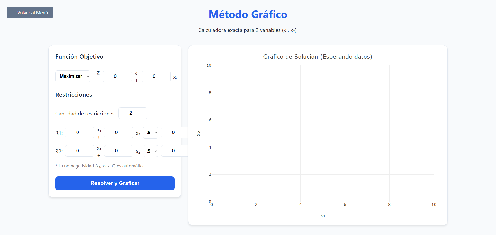
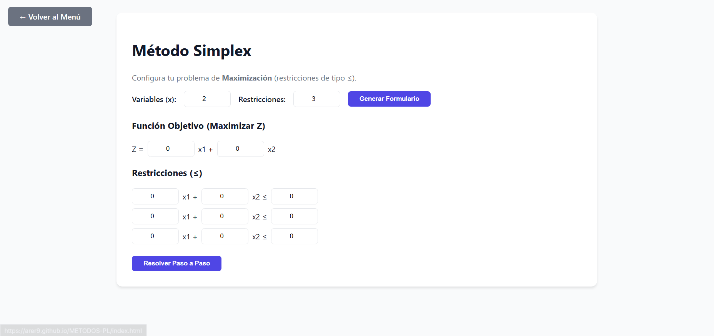

<div align="center">

# 📐 Métodos de Programación Lineal

### Resuelve problemas de optimización paso a paso, directo en tu navegador

<br>

[](https://arer9.github.io/METODOS-PL/)
[](https://arer9.github.io/METODOS-PL/)


<br>



</div>

---

## ✨ ¿Qué hace?

Una app web con dos calculadoras de **Programación Lineal**, pensada para estudiar y comprobar ejercicios sin instalar nada.

| 📊 Método Gráfico | 🧮 Método Simplex |
|:---|:---|
| Dibuja las restricciones y la **región factible** | Resuelve problemas de **maximización** (restricciones ≤) |
| Identifica los vértices y la **solución óptima** | Muestra cada **iteración paso a paso** |
| Ideal para problemas de **2 variables** | Número de variables y restricciones **configurable** |

### Además

- ⚡ Formulario dinámico que se genera según tu problema
- 🌐 Funciona 100% en el navegador, sin instalar nada
- 📱 Diseño limpio y responsivo

---

## 📸 Capturas

<div align="center">

### 📊 Método Gráfico


<br><br>

### 🧮 Método Simplex


</div>

---

## 🚀 Cómo usarlo

1. 🔗 Abre la [demo en vivo](https://arer9.github.io/METODOS-PL/)
2. 🎯 Elige el método: **Gráfico** o **Simplex**
3. ✍️ Ingresa la función objetivo y las restricciones
4. ▶️ Presiona **Resolver** y revisa el resultado

<details>
<summary><b>📝 Ver un ejemplo</b></summary>

<br>

**Maximizar** `Z = 3x₁ + 5x₂`

| Restricción | Expresión |
|:---:|:---|
| 1 | `x₁ ≤ 4` |
| 2 | `2x₂ ≤ 12` |
| 3 | `3x₁ + 2x₂ ≤ 18` |

✅ **Solución óptima:** `x₁ = 2`, `x₂ = 6`, `Z = 36`

</details>

---

## 📁 Estructura

```
METODOS-PL/
├── 📂 capturas/        → imágenes del README
├── 📄 index.html       → menú principal
├── 📄 Grafico.html     → método gráfico
├── 📄 Simplex.html     → método simplex
└── 📄 README.md
```

## 💻 Ejecutar localmente

```bash
git clone https://github.com/AreR9/METODOS-PL.git
cd METODOS-PL
```

Después abre `index.html` en tu navegador. No requiere instalación.

---

## 🔮 Próximas mejoras

- [ ] Restricciones ≥ e = (Gran M / Dos Fases)
- [ ] Minimización en Simplex
- [ ] Exportar la solución a PDF
- [ ] Modo oscuro

---

<div align="center">

### 👩‍💻 Hecho por **AreR9**

[](https://github.com/AreR9)

⭐ Si te sirvió, ¡dale una estrella al repo!

</div>
